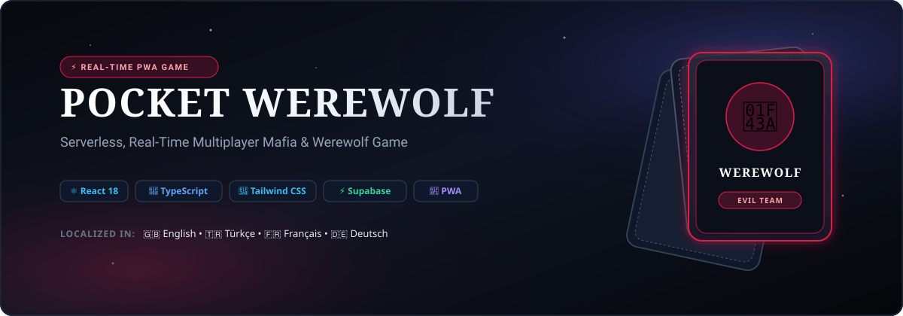
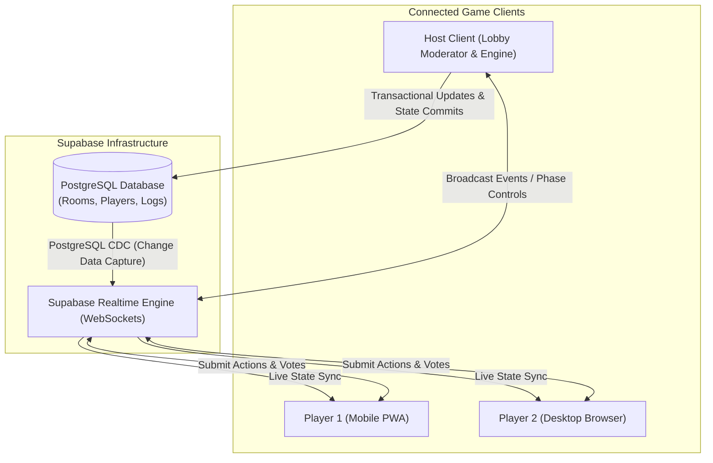

<!-- /* well-document · audit scorecard: G1:5 G2:5 G3:5 G4:5 G5:5 G6:5 · STATUS: PASS */ -->

<div align="center">



# Pocket Werewolf

**Serverless real-time multiplayer Werewolf and Mafia Progressive Web App built with React, Vite, and Supabase.**

[](https://github.com/AtaCanYmc/pocket-werewolf/actions/workflows/ci-cd.yml)
[](https://github.com/AtaCanYmc/pocket-werewolf/releases)
[](https://nodejs.org/)
[](https://react.dev/)
[](https://vitejs.dev/)
[](https://www.typescriptlang.org/)
[](https://tailwindcss.com/)
[](https://supabase.com/)
[](./LICENSE)

[Live Demo](https://AtaCanYmc.github.io/pocket-werewolf/) • [Bug Reports](https://github.com/AtaCanYmc/pocket-werewolf/issues) • [Feature Requests](https://github.com/AtaCanYmc/pocket-werewolf/issues) • [Roadmap](./ROADMAP.md)

</div>

---

## Table of Contents

- [Overview](#overview)
- [System Architecture](#system-architecture)
- [Quick Start](#quick-start)
  - [Prerequisites](#prerequisites)
  - [Installation Steps](#installation-steps)
  - [Environment Variables](#environment-variables)
  - [Database Initialization](#database-initialization)
  - [Verification](#verification)
- [Tech Stack](#tech-stack)
- [Game Flow and Phases](#game-flow-and-phases)
- [Roles Roster](#roles-roster)
- [Project Layout](#project-layout)
- [Deployment](#deployment)
- [Frequently Asked Questions](#frequently-asked-questions)
- [Governance and Contributing](#governance-and-contributing)
- [License](#license)

---

## Overview

Pocket Werewolf is a serverless adaptation of the social deduction game Werewolf (Mafia). The application replaces dedicated Socket.io game servers with Supabase PostgreSQL and Realtime Channels. State transitions, secret player roles, night actions, and town hall votes are synchronized across all connected clients via WebSockets under 50 milliseconds.

The frontend is a Progressive Web App (PWA) packaged with Vite and Workbox. It installs directly on iOS Safari and Android Chrome without app store distribution, stores assets locally for offline shell access, and generates game audio procedurally using the browser Web Audio API.

---

## System Architecture

The game engine operates on client-side state orchestration paired with Supabase PostgreSQL and Realtime Broadcast channels:



### Architectural Tenets

1. **Host-Authoritative Client State**: The room host acts as the authoritative coordinator for timer countdowns, phase transitions, and night action resolution.
2. **Row Level Security (RLS)**: PostgreSQL policies prevent players from reading or writing outside their designated room or player session.
3. **Optimistic Realtime Broadcasts**: In-game player votes, chat messages, and night action markers are broadcast across WebSocket channels before persisting to disk.

---

## Quick Start

### Prerequisites

| Tool | Version Requirement | Purpose |
| :--- | :--- | :--- |
| Node.js | `^20.19.0` or `>=22.12.0` | JavaScript runtime |
| npm | `>=10.0.0` | Package manager |
| Supabase Account | Free tier | PostgreSQL database and Realtime channel host |

### Installation Steps

1. Clone the repository and navigate into the workspace:

```bash
git clone https://github.com/AtaCanYmc/pocket-werewolf.git
cd pocket-werewolf
```

2. Install dependencies:

```bash
npm install
```

3. Configure environment credentials:

```bash
cp .env.example .env
```

### Environment Variables

| Variable Name | Required | Default | Description |
| :--- | :--- | :--- | :--- |
| `VITE_SUPABASE_URL` | Yes | None | Supabase project endpoint URL (`https://<project-ref>.supabase.co`) |
| `VITE_SUPABASE_ANON_KEY` | Yes | None | Supabase public anonymous API key |

Credentials may also be configured dynamically at runtime through the in-app Settings modal without editing `.env`.

### Database Initialization

1. Create a new project in the [Supabase Dashboard](https://supabase.com/dashboard).
2. Open the **SQL Editor** tab from the left sidebar.
3. Paste the contents of [`supabase/schema.sql`](./supabase/schema.sql) and execute the script.
4. Copy the project URL and anonymous public key from **Project Settings → API** into your `.env` file.

### Verification

Run the test suite and verify the production build:

```bash
# Execute unit tests
npm test

# Build production assets and verify TypeScript types
npm run build

# Start local development server
npm run dev
```

Open `http://localhost:5173` in your browser.

---

## Tech Stack

| Domain | Technology | Version | Purpose |
| :--- | :--- | :--- | :--- |
| Application Framework | React | `^19.3.0` | Declarative UI and phase component tree |
| Build Tool | Vite | `^8.3.0` | Development server and production bundling |
| Type System | TypeScript | `^7.0.2` | Strict static type validation |
| Styling | Tailwind CSS | `^3.4.17` | Utility-first styling with dark and light CSS variable tokens |
| Database and Realtime | Supabase JS | `^2.116.0` | PostgreSQL client, Realtime WebSockets, and presence tracking |
| Offline and Service Worker | vite-plugin-pwa | `^1.3.0` | Workbox service worker caching and manifest generation |
| Test Framework | Vitest | `^5.0.0` | Unit test execution for win conditions and phase services |
| Icons | Lucide React | `^1.47.0` | Tree-shaken interface iconography |
| Audio | Web Audio API | Native | Procedural sound generation without binary audio downloads |

---

## Game Flow and Phases

| Phase | Duration | Core Mechanics |
| :--- | :--- | :--- |
| **Lobby** | Indefinite | Room code generation, QR code sharing, role deck configuration, and ready check. |
| **Role Reveal** | Indefinite | Secret card reveal using 3D perspective flip with keyboard and touch interaction. |
| **Night Phase** | Configurable | Special role turns: werewolf hunting vote, seer inspection, doctor protection, and witch potions. |
| **Dawn Report** | 10 seconds | Automated casualty resolution, obituary reveal, and survival status update. |
| **Day Discussion** | Configurable | Open town debate with synchronized countdown timer and host pause controls. |
| **Town Hall Trial** | Configurable | Real-time vote tallying, tied vote resolution, and suspect execution animations. |
| **Game Over** | Indefinite | Victory condition evaluation for Villagers or Werewolves with identity reveal. |

---

## Roles Roster

### Villager Team

- **Villager**: Possesses no night abilities. Gathers information during day discussion and casts votes during town hall trials.
- **Seer**: Inspects one player per night to reveal whether the target belongs to the Good or Evil team.
- **Doctor**: Selects one player per night to protect against werewolf elimination. Can protect self.
- **Witch**: Holds a lethal poison potion to eliminate a chosen suspect during the night phase.
- **Hunter**: Fires a final retaliatory shot upon death, taking down a target player.
- **Mason**: Secret society members who recognize one another at the start of the match.

### Werewolf Team

- **Werewolf**: Awakens with the werewolf pack each night to choose a target to eliminate.
- **Dream Wolf**: A dormant werewolf who awakens into the active hunting pack once another werewolf dies.
- **Sorceress**: Inspects one player each night to locate the Seer and assist the werewolf pack.
- **Minion**: Works during the day to mislead town trials and protect werewolf identities.

---

## Project Layout

```text
pocket-werewolf/
├── .github/
│   ├── ISSUE_TEMPLATE/
│   │   ├── bug_report.yml       # Structured bug report issue form
│   │   ├── config.yaml          # Issue routing and security links
│   │   └── feature_request.yml  # Feature proposal issue form
│   ├── PULL_REQUEST_TEMPLATE/
│   │   └── pull_request_template.md # Pull request verification checklist
│   └── workflows/
│       ├── ci-cd.yml            # Automated testing and deployment workflow
│       └── release-please.yml   # Semantic release and changelog automation
├── public/
│   ├── assets/roles/            # Role vector artwork
│   ├── icons/                   # PWA application icons
│   ├── banner.svg               # Repository header graphic
│   └── favicon.ico              # Browser icon
├── src/
│   ├── components/
│   │   ├── common/              # Header, CardFlip, and TimerBar components
│   │   ├── game/                # Phase components (Lobby, Night, Day, Vote, GameOver)
│   │   └── modals/              # Settings, Role Guide, and PWA Install dialogs
│   ├── config/
│   │   └── roles.ts             # Role configurations, team presets, and deck builders
│   ├── context/
│   │   ├── GameContext.tsx      # Supabase Realtime synchronization provider
│   │   ├── ThemeContext.tsx     # Dark and light theme state manager
│   │   └── LanguageContext.tsx  # 4-language i18n context provider
│   ├── i18n/
│   │   └── translations.ts      # English, Turkish, French, and German dictionaries
│   ├── lib/
│   │   └── supabase.ts          # Supabase client instantiation and local persistence
│   ├── services/
│   │   ├── nightService.ts      # Night action aggregation and casualty resolution
│   │   ├── roomService.ts       # Room lifecycle, player joining, and host departure
│   │   ├── voteService.ts       # Live vote tallying and execution processing
│   │   └── winCondition.ts      # Game over evaluation rules
│   ├── types/
│   │   └── game.ts              # Strict TypeScript models and state interfaces
│   ├── utils/
│   │   └── audio.ts             # Web Audio API procedural sound synthesizer
│   ├── App.tsx                  # Root application router and layout shell
│   ├── index.css                # Tailwind directives and CSS theme variables
│   └── main.tsx                 # Client application entry point
├── supabase/
│   └── schema.sql               # PostgreSQL tables, RLS policies, and stored procedures
├── tests/
│   ├── context/                 # Context provider test suites
│   └── services/                # Win condition, night, and vote service test suites
├── .editorconfig                # Universal indentation and whitespace rules
├── .gitattributes               # Cross-platform line ending normalization
├── .markdownlint.json           # Markdown lint configuration
├── CONTRIBUTING.md              # Contribution standards and development guidelines
├── LICENSE                      # GNU General Public License v3.0
├── ROADMAP.md                   # Completed releases and upcoming milestone targets
├── SECURITY.md                  # Vulnerability disclosure policy and response SLA
├── package.json                 # Project dependencies, scripts, and engine constraints
├── tailwind.config.js           # Tailwind theme configuration
├── tsconfig.json                # TypeScript compiler configuration
└── vite.config.js               # Vite build configuration and PWA plugin rules
```

---

## Deployment

### Option 1: Vercel

1. Import the repository into your Vercel team dashboard.
2. Set the Framework Preset to **Vite**.
3. Supply `VITE_SUPABASE_URL` and `VITE_SUPABASE_ANON_KEY` under **Environment Variables**.
4. Deploy the project. The build pipeline executes `tsc && vite build` and generates the production PWA bundle.

### Option 2: GitHub Pages

The repository contains an automated GitHub Actions deployment workflow at `.github/workflows/ci-cd.yml`.

1. Go to repository **Settings → Pages**.
2. Set **Build and deployment > Source** to **GitHub Actions**.
3. Pushes to `main` compile assets and publish to GitHub Pages automatically.
4. Configure Supabase credentials at runtime inside the in-app Settings dialog.

---

## Frequently Asked Questions

<details>
<summary><b>Why use Supabase Realtime instead of a dedicated Node.js WebSocket server?</b></summary>
<br>

A dedicated Node.js server requires persistent compute resources, horizontal scaling mechanisms, and container orchestration. Pocket Werewolf leverages Supabase Realtime channels and PostgreSQL row changes directly from client browsers. This eliminates backend server maintenance, achieves sub-50ms broadcast latency, and allows the game to run at zero hosting cost.
</details>

<details>
<summary><b>How are abandoned lobbies and old game records garbage collected?</b></summary>
<br>

Orphaned records are cleaned through a three-tier system:
1. When a room host departs a lobby without active players, the room is deleted immediately. Foreign key constraints with `ON DELETE CASCADE` simultaneously purge associated player rows, action records, votes, and chat logs.
2. Client startup executes an opportunistic maintenance check that cleans unstarted rooms older than 6 hours and completed games older than 24 hours.
3. The stored procedure `cleanup_stale_rooms()` in `supabase/schema.sql` can be scheduled via `pg_cron` for automated database-level maintenance.
</details>

<details>
<summary><b>How does procedural audio synthesis work without media downloads?</b></summary>
<br>

Instead of downloading static MP3 or WAV audio assets over mobile connections, `src/utils/audio.ts` uses the native browser Web Audio API. Audio oscillators, gain nodes, and biquad filters synthesize wolf howls, church bells, death gongs, and victory fanfares on the client device. This eliminates network bandwidth consumption and provides immediate audio playback.
</details>

<details>
<summary><b>Does the Progressive Web App function offline?</b></summary>
<br>

The application shell, role illustrations, fonts, and interface styling are cached locally by the Workbox service worker on initial load. Offline users can open the application, configure settings, and read the role guide. Active multiplayer gameplay requires an internet connection to communicate with Supabase Realtime channels.
</details>

---

## Governance and Contributing

Contributions must follow the standards outlined in our project governance files:

- Review [CONTRIBUTING.md](./CONTRIBUTING.md) for branch naming conventions, Conventional Commit formatting, and verification procedures.
- Review [SECURITY.md](./SECURITY.md) for vulnerability disclosure protocols and our 48-hour response SLA.
- Review [CODE_OF_CONDUCT.md](./CODE_OF_CONDUCT.md) for community interaction standards.
- Review [ROADMAP.md](./ROADMAP.md) for planned release milestones.

---

## License

Pocket Werewolf is open-source software licensed under the [GNU General Public License v3.0](./LICENSE).
